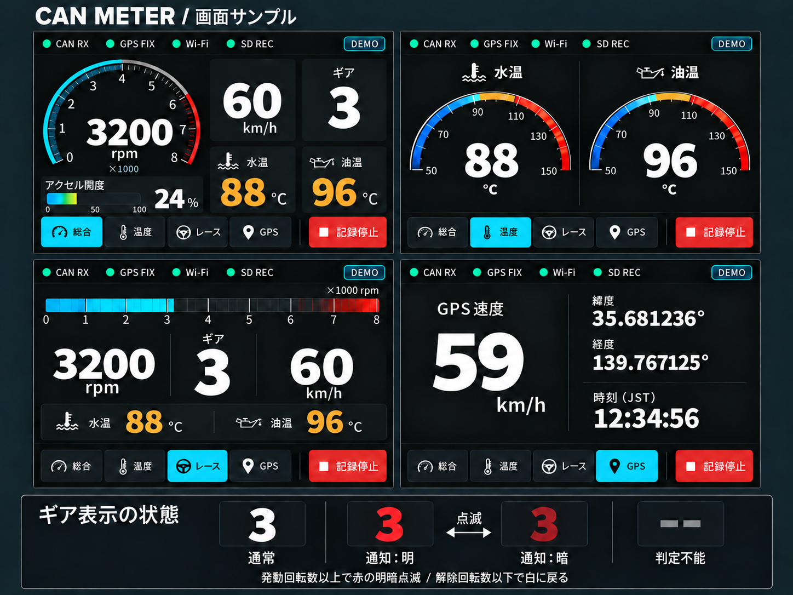

# 3. 仮データによるメーター画面実装

## 目的・対応要件

実車接続前に、4画面の表示・切り替え・無効値表示を確認する。
対応：UI-01〜10、CAN-08、DEV-06、TEST-04・10。
前提：[段階2](02_メイン機の基本動作.md)の画面・タッチが動作すること。

## 画面構成

| 画面 | 表示内容 |
| --- | --- |
| 総合 | 回転数、CAN車速、水温、油温、ギアポジション、アクセルペダル開度 |
| 温度重視 | 水温、油温を大きく表示 |
| レース | 横長の回転数バー、回転数、ギアを大きく表示し、CAN車速・水温・油温を併記 |
| GPS | GPS速度、緯度・経度、日本時間 |

全画面から切り替えボタンを操作できるようにする。CAN・GPS・Wi-Fi・SDの状態表示と、記録停止操作の領域も用意する。

## 確定した画面デザイン

左上が総合、右上が温度重視、左下がレース、右下がGPS。本画像を初期実装の画面デザインとして確定する。組み込みimage_genツールで作成した画像で、数値は仮データ。
各画面は800×480の実機画面を想定する。実装は本画像の構成・配色を基準とし、文字の可読性や目盛りの正確さに必要な細部を調整する。温度の色分けは警告閾値の確定仕様としない。

画面のギアラベルは「ギア」とし、「推定」は表示しない。総合画面のアクセルバーはグラデーション表示とする。ギアの取得方法は実車で確認し、内部仕様で管理する。

アクセルバーは目盛り全体の0%を青、50%を黄、100%を赤とする固定グラデーションを、実際の開度まで表示する。未充填部分は暗色とし、現在の塗り幅の中へ全色を圧縮しない。画像は見た目の参考とし、塗り幅・色位置の正確さはLVGL実装で調整する。

## レース画面の表示方針

- 総合画面のタコメーターに「エンジン回転数」のラベルは表示しない。回転数の数値・rpm・目盛りは維持する。
- 総合・レース画面の速度は数値と「km/h」のみを表示し、「CAN車速」のラベルは表示しない。データ源はCAN車速のままとし、GPS画面の「GPS速度」ラベルは維持する。
- 上部に横長の回転数バーを配置し、中央のギアと回転数・車速を大きく表示する。
- 水温・油温を補助表示し、総合画面と同じデータを参照する。
- ギアのラベルは「ギア」のみとし、判定不能時は「--」とする。
- 回転数バーの目盛りと高回転側の色は実装時に調整する。回転数通知は下記のギア数字の色変更・点滅で行う。
- 操作画面は削除する。ブレーキ・舵角の表示を省いても、全受信CANフレームのログ保存は継続する。

## 回転数通知：ギア数字の色変更・点滅

総合・レース画面に共通で実装する。画像内の両画面は通常時の白点灯とし、下部に通常・通知の明暗・判定不能の状態見本を示す。下部の見本は説明用で、実機画面の一部ではない。静止画像では点滅の時間変化を表現しない。

| 状態 | ギア表示 |
| --- | --- |
| 通常 | 白で点灯 |
| 有効な回転数が発動値以上 | 明るい赤と暗い赤を交互に表示し、数字を消さずに点滅 |
| 通知中に回転数が解除値以下 | 白の点灯へ戻す |
| ギア判定不能・無効 | 「--」をグレーで表示し、点滅しない |
| 回転数無効・更新停止 | 通知を解除し、有効なギアは白、無効なギアはグレーの「--」 |

- 発動回転数・解除回転数・点滅周期を設定値として持つ。画面上の設定メニュー追加は本変更の対象としない。
- 解除値は発動値より低くし、その間では直前の通知状態を維持してちらつきを抑える。不正な設定のまま通知を有効にしない。
- 数値は実装時に決める。実車の限界回転数やエンジン保護を保証する設定とは扱わない。
- 通知状態と点滅位相は共通管理し、画面切り替えでリセットしない。LVGLのタイマー等を用い、待機処理で描画・受信・記録を止めない。
- 回転数が無効になった場合は過去の値で通知し続けず、有効な値が再到着した際に発動値以上かを判定し直す。
- 本機能は表示によるシフト目安であり、CAN送信やエンジン制御は行わない。

## 作業手順

1. 車両情報を共通データ構造にまとめる。項目ごとに値・単位・有効性・最終受信時刻を持たせる。
2. 仮データ生成処理を用意し、一定値・連続変化・未取得・異常値・更新停止を発生させる。
3. 4画面をLVGLで作成する。仮データであることが分かる表示を付ける。
4. 車両情報の表示更新を100ms周期とする。GPS表示は新しい測位結果を受け取ったときに更新する。
5. 無効な値を「--」とし、取得済みの0、ブレーキOFFと区別する。
6. タッチボタンによる画面切り替えを実装する。切り替え処理から受信・記録の停止処理を呼び出さない。
7. データ取得処理と描画処理を分け、画面は共通データの最新状態を参照する。共有データの保護方法とLVGL操作の実行場所を決める。
8. 同じ項目が複数画面に出る場合、切り替え後も値と状態が一致することを確認する。

## 確認ケース

- 通常はギアが白で点灯し、発動値以上で明暗の赤に点滅する。数字が完全には消えない。
- 解除値より大きく発動値未満の範囲では直前の通知状態を維持し、解除値以下で白へ戻る。
- ギア無効時はグレーの「--」を優先し、回転数無効・更新停止時は通知を解除する。
- 通知中に総合・レース画面を切り替えても通知状態・位相を維持し、受信・記録を継続する。
- 総合画面は6項目を表示し、画面ラベルは「ギア」とし、「推定」は表示しない。取得方法は内部仕様で区別する。サンプルでは「ギア 3」「アクセル開度24%」を使用する。
- ギア推定は回転数・車速の有効性と整合性を確認し、停車中・クラッチ操作中など判定不能時には「--」を表示する。N・Rを推定だけで確定しない。
- 値が増減しても単位・符号・桁表示が崩れない。
- タイムアウト後に過去の値を現在値として表示し続けない。
- 未対応項目と、通信全体の未受信状態を区別できる。
- 画面を繰り返し切り替えてもメモリー使用量が増え続けない。
- 仮データの受信時刻から描画反映までの時間を測定できる。

表示遅延の初期目標は200ms以内。描画要求時刻と実際の画面反映時刻を区別し、測定方法を記録する。最終判定は段階8の同時動作で行う。

## 成果物・完了条件

- [ ] 4画面の画面案と表示項目・単位を保存した。
- [ ] タッチ操作で切り替えられ、仮データの更新が止まらない。
- [ ] 未取得・異常・更新停止の表示を確認した。
- [ ] 実データ供給元へ差し替えられる共通データ構造がある。

次は[GPS・通信](04_GPSと通信.md)へ進む。
